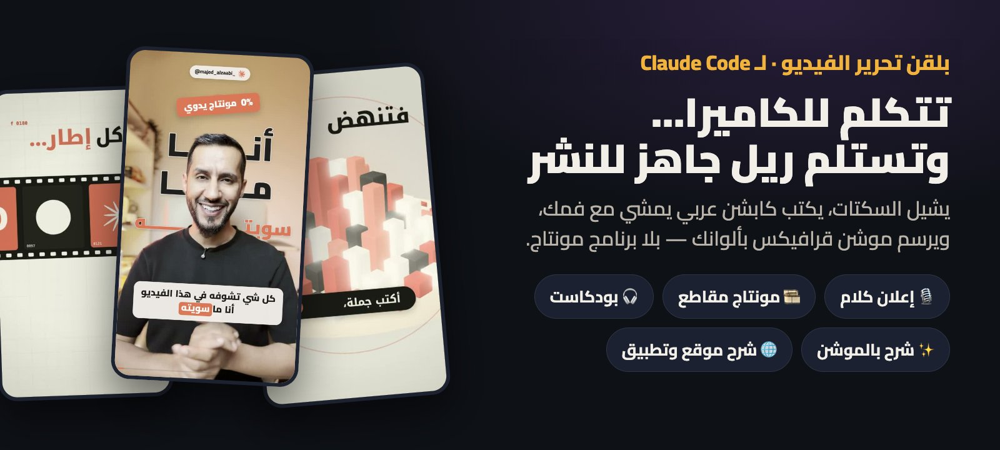
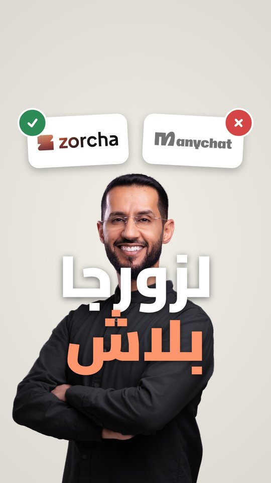
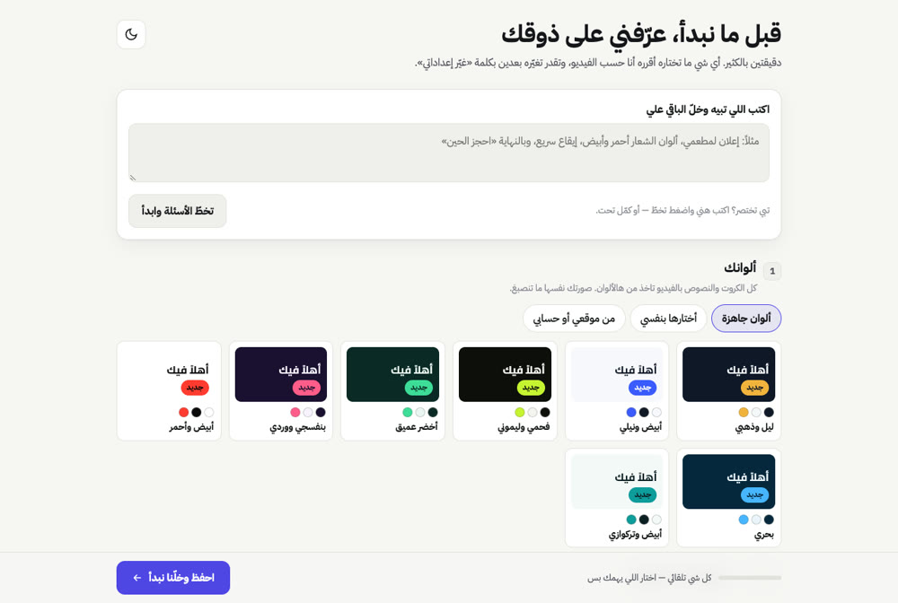

> Based on [majedphotos/video-ad-editor](https://github.com/majedphotos/video-ad-editor) by Majed Alzaabi (MIT).

<p align="center"></p>

# video-ad-editor

<div dir="rtl">

**مونتاج فيديو عربي داخل Claude Code — بلا برنامج مونتاج.** ترفق الفيديو وتكتب جملة («حوّل هذا لريل»)، والمونتاج كله يصير بالكود: ffmpeg للقص، وِسبر للكلام، ومحرّك رسم للكابشن والموشن.

سكل واحد بخمسة أوضاع، يتذكّر سلاسلك وأسلوبك، ويتعلّم من ملاحظاتك.

</div>

**Arabic video editing inside Claude Code, without an editing app.** Attach a clip, write one sentence, and the edit happens in code: ffmpeg cuts, Whisper transcribes, a headless-browser engine draws captions and motion. One skill, five modes, series profiles and a lessons loop.

---

## التثبيت · Install

<div dir="rtl">

من الطرفية (أو نفس الأوامر داخل Claude Code بعد `/plugin`):

</div>

From a local clone:

```
claude plugin marketplace add C:/path/to/video-ad-editor
claude plugin install video-ad-editor@7mxd-plugins
```

From GitHub:

```
claude plugin marketplace add 7mxd/video-ad-editor
claude plugin install video-ad-editor@7mxd-plugins
```

<div dir="rtl">

أول مرة تطلب فيديو، السكل يفحص الأدوات بنفسه (ffmpeg، Node، بايثون، كروم أو إيدج، وِسبر) ويجهّز الناقص بعد ما يستأذنك. التحديثات من مدير البلقنات (`claude plugin update`) — السكل ما ينزّل شي بنفسه.

</div>

On first use the skill checks its tools itself (ffmpeg, Node, Python, Chrome or Edge, Whisper) and offers to install what is missing (`scripts/00_setup.sh`; optional extras with `--extras`). Updates come from the plugin manager only; the skill never downloads itself.

---

## الأوضاع الخمسة · The 5 modes

| | وضع · Mode | تكتب · You say |
|---|---|---|
| 🎙️ | **ريل من فيديو كلام** — يشيل السكتات، كابشن مع الكلام، موشن من المعنى · *Talking-head reel or ad* | «حوّل الفيديو لريل» |
| ✨ | **موشن** — فيلم من نص أو فكرة، شرح موقع أو تطبيق، «اشرح لي شلون يشتغل …» · *Motion explainer* | «سو فيديو موشن من هالنص» |
| 🎧 | **بودكاست** — كاميرتين، الحلقة كاملة 16:9، أو ريلات من حلقة طويلة · *Podcast / multi-cam* | «سو ريلات من الحلقة» |
| 🎞️ | **مونتاج** — مجلد مقاطع بلا كلام ← ريل على الإيقاع أو على فويس · *Montage* | «مونتاج من هالمقاطع» |
| 🖼️ | **كفر وثمبنيل** — كفر الريل وثمبنيل يوتيوب · *Covers and thumbnails* | «سو كفر» · «ثمبنيل يوتيوب» |

<p align="center"></p>

<div dir="rtl">

وفوقها: مشروع كاب كت بدل MP4 («سوّه بكاب كت»)، واستوديو تعدّل فيه بإيدك («افتح الاستوديو»). الكاروسيل مو من شغل هالسكل.

</div>

Also: a CapCut project instead of an MP4, and a local studio for hand edits. Carousels are out of scope.

---

## السلاسل والدروس · Series and lessons

<p align="center"></p>

<div dir="rtl">

- **السلسلة** = لمين الفيديو (بطاقة لكل سلسلة: الجمهور، اللهجة، الكابشن، الطول). تقول اسمها أو يعرفها من المجلد، وإذا ما عرف يسألك مرة.
- **الأسلوب** = شلون ينمنتج هالفيديو بالذات (كلام للكاميرا، شرح، بودكاست، مونتاج إيقاع، مونتاج فويس، درس). يقولك اختياره بسطر وتقدر تغيّره.
- **الدروس:** بعد ما تعتمد الفيديو، كل تصحيح طلبته يصير قاعدة بسطر (لهالسلسلة بس أو لكل الفيديوهات — يسألك)، فما يتكرر الغلط بالفيديو الجاي.

كل هذا محفوظ برا السكل تحت `VAE_HOME` (الافتراضي `~/.video-ad-editor`)، فالتحديث ما يمسحه.

</div>

- **Series** cards hold audience, dialect, caption policy and length per series.
- **Approach** is chosen per video (talking head, explainer, podcast, beat montage, voice montage, tutorial) and stated in one line.
- **Lessons**: after you approve a video, each correction you asked for is saved as a one-line rule, for that series or for all videos (it asks which).

Everything lives outside the plugin under `VAE_HOME` (default `~/.video-ad-editor`), so updates never touch it (`scripts/lessons.py`).

---

## البلر · Privacy blur

<div dir="rtl">

«بلّر الرقم» أو «غطِّ الشاشة»: تحدد الهدف مرة (صورة مرجع أو مربع على فريم)، والسكل يتتبّعه قدّام وورا ويبلّره قبل الكابشن والموشن. إذا شك بالتتبّع يوسّع البلر بدل ما يكشف، وإذا ضاع الهدف أكثر من ثانية يوقف ويسألك (تحدده من جديد أو توافق على شريط بعرض الفريم). ما فيه كشف تلقائي للوجوه — أنت تحدد الهدف.

</div>

Ask to blur a number, screen, paper, plate or face. You mark the target once (a reference image or a box on one frame); `scripts/blur_track.py` tracks it both ways and blurs it before captions and motion are drawn. Uncertain frames get a wider blur; if the target is lost for more than a second the render is refused until you re-mark it or accept a full-width band. Each run prints a one-line numeric summary. Needs OpenCV (`scripts/00_setup.sh --extras`). There is no automatic face detection.

---

## ويندوز · Windows notes

<div dir="rtl">

- اكتب `python` دائماً — الاسم اللي آخره 3 على ويندوز اختصار متجر مايكروسوفت ويفشل (على الماك/لينكس بدون `python` استخدم `python3`). سكربتات الـshell تلقى المفسّر بنفسها.
- كروم يُكتشف تلقائياً (كروم ثم إيدج). مكانه غير عادي؟ حط المسار بـ`CHROME_PATH`.
- يشتغل من Git Bash. مرّر المسارات بشكل `C:/…`.
- خصائص ماك فقط: «الكلام ورا الشخص»، وضع البودكاست بالكاميرتين (تتبّع الوجوه)، أنماط القص الثلاثة، ومحوّل HDR للآيفون. السكربت يوقف برسالة واضحة.

</div>

- Always `python` (on Windows the Store alias with a 3 at the end fails); on Mac/Linux without `python`, use `python3`. Shell scripts find the interpreter themselves.
- Chrome is found automatically (Chrome, then Edge). Set `CHROME_PATH` if it lives somewhere unusual.
- Run from Git Bash; pass paths as `C:/…`.
- Mac-only features: text behind the person, multi-cam podcast (face tracking), the three cut styles, the iPhone HDR converter. The scripts stop with a clear message on Windows.
- Fonts are bundled, so rendering works offline. The studio listens on `127.0.0.1` only; `--lan` opens it to your network with a token.

---

## الحالة · Status

See [STATUS.md](STATUS.md) and [CHANGELOG.md](CHANGELOG.md). The audit behind this rebuild is in [docs/AUDIT.md](docs/AUDIT.md).

## الرخصة · License

MIT — see [LICENSE](LICENSE). Original work © Majed Alzaabi; this rebuild © 7mxd.
